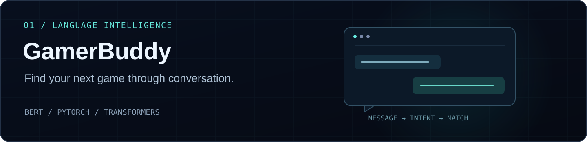
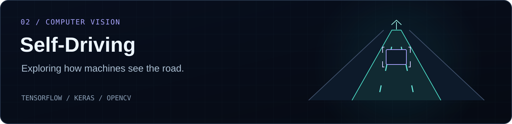
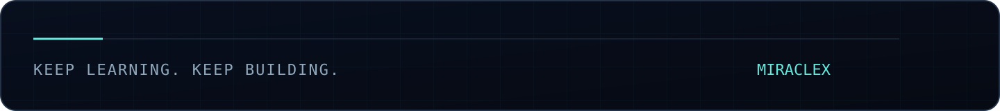

  

  <a href="#selected-projects">Selected projects</a> &nbsp; / &nbsp;
  <a href="#toolbox">Toolbox</a> &nbsp; / &nbsp;
  <a href="https://github.com/xAnyaForger?tab=repositories">All repositories</a>

### Hey, I'm MiracleX.

I build projects around **AI, natural language processing, and computer vision** — from a chatbot that helps people discover games to systems that interpret the road.

I like turning an idea into something you can actually use, then figuring out how to make it better.

## Selected projects

**[GamerBuddy ↗](https://github.com/xAnyaForger/GamerBuddy)** · A desktop chatbot for discovering Steam games. Combines BERT intent recognition, preference-based filtering, and language models for conversation and game descriptions.

`Python` `PyTorch` `Hugging Face Transformers` `CustomTkinter`

 

**[Self-Driving ↗](https://github.com/xAnyaForger/Self-Driving)** · A computer vision project exploring lane detection, vehicle detection, and steering detection for autonomous navigation.

`Python` `TensorFlow` `Keras` `OpenCV`

Project artwork illustrates each system's focus; it is not a screenshot or a measured result.

## Toolbox

| Area | Tools I've used in these projects |
| :--- | :--- |
| Languages | Python |
| Deep learning | PyTorch · TensorFlow · Keras |
| Language models | Hugging Face Transformers · BERT |
| Vision & data | OpenCV · NumPy · Pandas · scikit-learn |
| Desktop interfaces | CustomTkinter |

## Let's connect

Interested in AI, useful software, or games? Explore my projects and follow along as I build.

**[Browse my repositories ↗](https://github.com/xAnyaForger?tab=repositories)**

 

