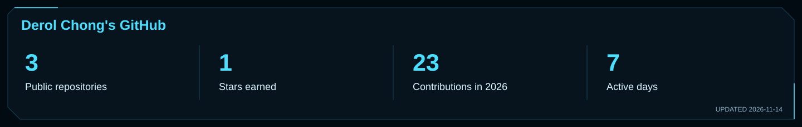
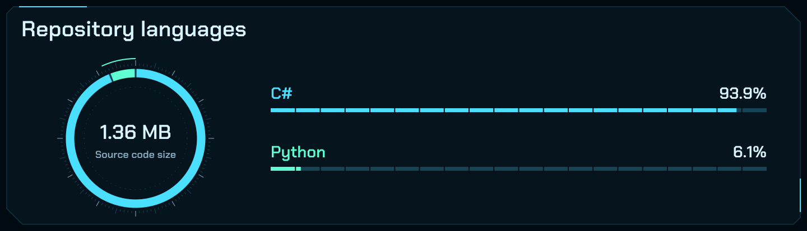
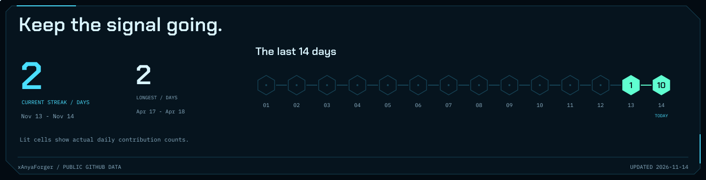

<picture>
  <source media="(max-width: 640px) and (prefers-reduced-motion: reduce)" srcset="assets/hud-mobile-still.svg" />
  <source media="(max-width: 640px)" srcset="assets/hud-mobile.svg" />
  <source media="(prefers-reduced-motion: reduce)" srcset="assets/hud-still.svg" />
  
</picture>

I'm **Derol Chong**. I work with **AI and machine learning**, especially natural language processing and computer vision. My projects explore how models can power useful applications—from finding games through conversation to interpreting the road.

[Repositories](https://github.com/xAnyaForger?tab=repositories) · [Featured projects](#featured-projects) · [Tech stack](#tech-stack) · [GitHub analytics](#github-analytics)

## About

- **Focus:** AI & machine learning applications.
- **Interests:** natural language processing, computer vision, and deep learning.
- **Building:** conversational desktop applications and visual perception systems.

## Featured Projects

<table width="100%">
<thead>
<tr><th align="left" width="20%">Project</th><th align="left" width="50%">What it does</th><th align="left" width="30%">Tech stack</th></tr>
</thead>
<tbody>
<tr>
<td valign="top"><a href="https://github.com/xAnyaForger/GamerBuddy"><b>GamerBuddy</b></a> Conversational game recommendations</td>
<td valign="top">Helps users discover Steam games through natural conversation. Uses <b>BERT intent recognition</b>, genre/budget/rating filters, and language models for chat and game descriptions.</td>
<td valign="top"><code>Python</code> <code>PyTorch</code> <code>Transformers</code> <code>CustomTkinter</code></td>
</tr>
<tr>
<td valign="top"><a href="https://github.com/xAnyaForger/Self-Driving"><b>Self-Driving</b></a> Computer vision for road perception</td>
<td valign="top">Explores <b>lane detection, vehicle detection, and steering detection</b> for autonomous navigation.</td>
<td valign="top"><code>Python</code> <code>TensorFlow</code> <code>Keras</code> <code>OpenCV</code></td>
</tr>
</tbody>
</table>

## Tech Stack

<table width="100%">
<tbody>
<tr><th align="left" width="25%" scope="row">Language</th><td></td></tr>
<tr><th align="left" scope="row">AI / Machine Learning</th><td>    </td></tr>
<tr><th align="left" scope="row">Vision &amp; Data</th><td>  </td></tr>
<tr><th align="left" scope="row">Desktop Applications</th><td></td></tr>
</tbody>
</table>

## GitHub Analytics

<picture>
  <source media="(max-width: 640px)" srcset="assets/analytics-stats-mobile.svg" />
  
</picture>

<picture>
  <source media="(max-width: 640px)" srcset="assets/analytics-languages-mobile.svg" />
  
</picture>

<picture>
  <source media="(max-width: 640px)" srcset="assets/analytics-streak-mobile.svg" />
  
</picture>

### Neuron Quest

A curious little neuron hops between my real contribution days, gathers data sparks, and grows a constellation. Bigger coding days give it a bigger burst of sparks.

<picture>
  <source media="(max-width: 640px) and (prefers-reduced-motion: reduce)" srcset="assets/analytics-quest-mobile-still.svg" />
  <source media="(max-width: 640px)" srcset="assets/analytics-quest-mobile.svg" />
  <source media="(prefers-reduced-motion: reduce)" srcset="assets/analytics-quest-still.svg" />
  
</picture>

Stats use public GitHub data and update through the included workflow. Language percentages describe repository bytes, not proficiency. Neuron Quest is an illustrative story driven by actual active dates and contribution counts.

---

**[Explore my repositories](https://github.com/xAnyaForger?tab=repositories)**
