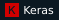
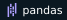
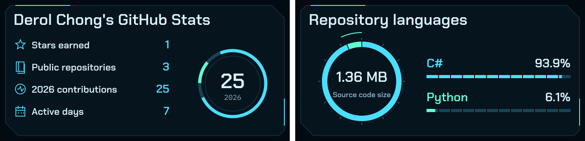

<picture>
  <source media="(max-width: 640px) and (prefers-reduced-motion: reduce)" srcset="assets/hud-mobile-still.svg" />
  <source media="(max-width: 640px)" srcset="assets/hud-mobile.svg" />
  <source media="(prefers-reduced-motion: reduce)" srcset="assets/hud-still.svg" />
  
</picture>

I'm **Derol Chong**. I work with **AI and machine learning**, especially natural language processing and computer vision. My projects explore how models can power useful applications—from finding games through conversation to interpreting the road.

[Repositories](https://github.com/xAnyaForger?tab=repositories) · [Featured projects](#featured-projects) · [Tech stack](#tech-stack) · [GitHub analytics](#github-analytics)

## About

- **Focus:** AI & machine learning applications.
- **Interests:** natural language processing, computer vision, and deep learning.
- **Building:** conversational desktop applications and visual perception systems.

## Featured Projects

<table width="100%">
<thead>
<tr><th align="left" width="20%">Project</th><th align="left" width="50%">What it does</th><th align="left" width="30%">Tech stack</th></tr>
</thead>
<tbody>
<tr>
<td valign="top"><a href="https://github.com/xAnyaForger/GamerBuddy"><b>GamerBuddy</b></a> Conversational game recommendations</td>
<td valign="top">Helps users discover Steam games through natural conversation. Uses <b>BERT intent recognition</b>, genre/budget/rating filters, and language models for chat and game descriptions.</td>
<td valign="top"><code>Python</code> <code>PyTorch</code> <code>Transformers</code> <code>CustomTkinter</code></td>
</tr>
<tr>
<td valign="top"><a href="https://github.com/xAnyaForger/Self-Driving"><b>Self-Driving</b></a> Computer vision for road perception</td>
<td valign="top">Explores <b>lane detection, vehicle detection, and steering detection</b> for autonomous navigation.</td>
<td valign="top"><code>Python</code> <code>TensorFlow</code> <code>Keras</code> <code>OpenCV</code></td>
</tr>
</tbody>
</table>

## Tech Stack

<table width="100%">
<tbody>
<tr><th align="left" width="25%" scope="row">Language</th><td></td></tr>
<tr><th align="left" scope="row">AI / Machine Learning</th><td>    </td></tr>
<tr><th align="left" scope="row">Vision &amp; Data</th><td>  </td></tr>
<tr><th align="left" scope="row">Desktop Applications</th><td></td></tr>
</tbody>
</table>

## GitHub Analytics

<picture>
  <source media="(max-width: 640px) and (prefers-reduced-motion: reduce)" srcset="assets/analytics-top-row-mobile-still.svg" />
  <source media="(max-width: 640px)" srcset="assets/analytics-top-row-mobile.svg" />
  <source media="(prefers-reduced-motion: reduce)" srcset="assets/analytics-top-row-still.svg" />
  
</picture>

<picture>
  <source media="(max-width: 640px) and (prefers-reduced-motion: reduce)" srcset="assets/analytics-streak-centered-mobile-still.svg" />
  <source media="(max-width: 640px)" srcset="assets/analytics-streak-centered-mobile.svg" />
  <source media="(prefers-reduced-motion: reduce)" srcset="assets/analytics-streak-centered-still.svg" />
  
</picture>

<picture>
  <source media="(max-width: 640px) and (prefers-reduced-motion: reduce)" srcset="assets/world-arcade-mobile-still.svg" />
  <source media="(max-width: 640px)" srcset="assets/world-arcade-mobile.svg" />
  <source media="(prefers-reduced-motion: reduce)" srcset="assets/world-arcade-still.svg" />
  
</picture>

---

**[Explore my repositories](https://github.com/xAnyaForger?tab=repositories)**
